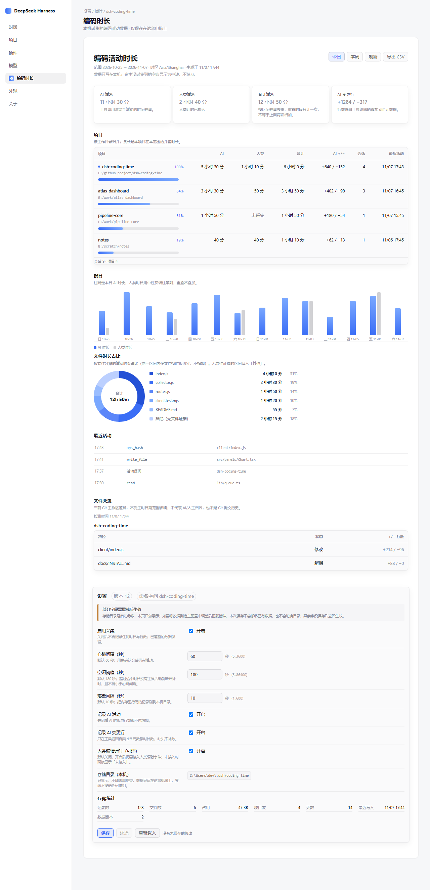
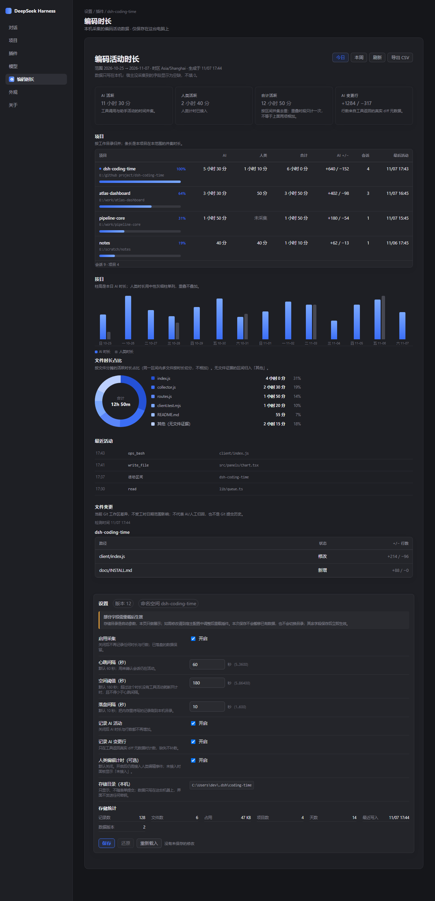
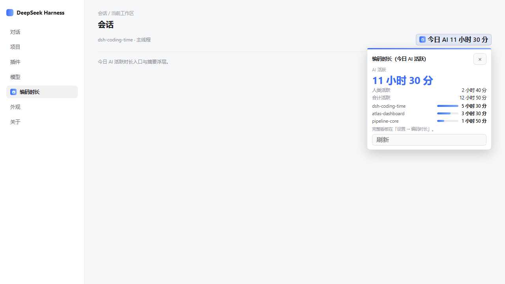

# dsh-coding-time

Local coding-activity timing for the DeepSeek Harness (DSH). It measures
wall-clock active time per project (`cwd`), counts added/deleted lines from real
diff metadata, and can optionally time human edits. All data stays on this
machine under `~/.dsh` — no account, no network service, no telemetry.



<details>
<summary>Dark theme</summary>



</details>

The session header shows today's AI active time at a glance and opens a compact
summary popover.



## What it does

- **Active time by project.** Records wall-clock intervals of AI activity
  (tool calls and assistant events), grouped by working directory. Overlapping
  intervals are merged into a union, so the total is never a simple sum.
- **Real line accounting.** Added and deleted lines come only from explicit diff
  metadata returned by tools. Missing metadata stays unknown — it is never
  filled in as zero.
- **Optional human timing.** Off by default. It becomes available only when an
  editor integration supplies explicit real-input evidence.
- **Time by file.** Active intervals are apportioned across the files they touch
  and shown as a donut chart, with a per-file share breakdown.
- **Project ranking.** Projects are listed by union active time with a duration
  bar and a percentage of the leading project.
- **Daily activity.** A bar chart of AI (and, when connected, human) time per day.
- **Recent activity and file changes.** A short timeline of recent events, plus
  a read-only snapshot of the current Git working tree per project.
- **Settings.** Heartbeat, idle and flush intervals, collection switches, the
  local storage directory and storage statistics — all editable in the Host's
  settings page when a writable config namespace is available.
- **CSV export.** Download the summary as CSV; unknown values stay distinct
  from zero.

## How it stays local

The Web dashboard mounts onto the Harness's existing `webServer` — the plugin
adds no HTTP listener of its own. It reads from same-origin local routes and
writes JSONL under `<storageDirectory>/<profile>/`. There is no third-party
API call, no outbound statistics, and no credentials stored or read by the UI.
Runtime code uses only Node built-ins; the settings form uses the Host-provided
`@deepseek-ai/schemastery` peer dependency to build its config schema.

Uncollected or not-connected values are shown as such (for example "not
collected" or "not connected"), never as a fabricated `0`.

## Install

From npm:

```
npm install dsh-coding-time@0.1.1
dsh plugin --profile web add dsh-coding-time
```

Or straight from the GitHub repository:

```
dsh plugin --profile web add 'https://github.com/Dclef/dsh-coding-time'
```

Requires Node `>=22.14.0` and a running Harness with the `dsh` CLI on `PATH`.
See [docs/INSTALL.md](docs/INSTALL.md) for details.

## Configuration (defaults)

| Field | Default |
| --- | --- |
| `enabled` | `true` |
| `heartbeatIntervalSeconds` | `60` |
| `idleThresholdSeconds` | `180` |
| `flushIntervalSeconds` | `10` |
| `trackAgentActivity` | `true` |
| `trackAiLines` | `true` |
| `humanTracking.enabled` | `false` |
| `storageDirectory` | `~/.dsh/coding-time` |
| `timezone` | local IANA zone |
| `weekStartsOn` | `1` (Monday) |
| `exclude` | common build, VCS and secret paths |

`idleThresholdSeconds` must be at least `heartbeatIntervalSeconds`. Unknown
fields, credential fields, invalid numbers, invalid timezones and non-absolute
directories are rejected rather than silently clamped.

## What's new in 0.1.1

- Reuses cached `Intl.NumberFormat` and `Intl.DateTimeFormat` instances in the dashboard.
- Keeps cache entries separate by locale and timezone, preserves invalid-input fallbacks, and caps each cache at 32 entries.

## Development

```
npm test                                   # full test suite
npm run check                              # syntax-check every .js source file
node --test test/summary-contract.test.mjs # real apply + /summary HTTP contract
npm pack --dry-run                         # offline packaging check
```

## Status

Experimental, local-only, published as source for review and self-hosting.
Settings are editable only when the Host exposes this plugin's own writable
Config namespace; otherwise the client shows an explicit read-only state and
sends zero save requests. Automated tests passing is not a claim of manual
browser acceptance.

## License

MIT — see [LICENSE](LICENSE).

Chinese documentation: [README.zh.md](README.zh.md).
