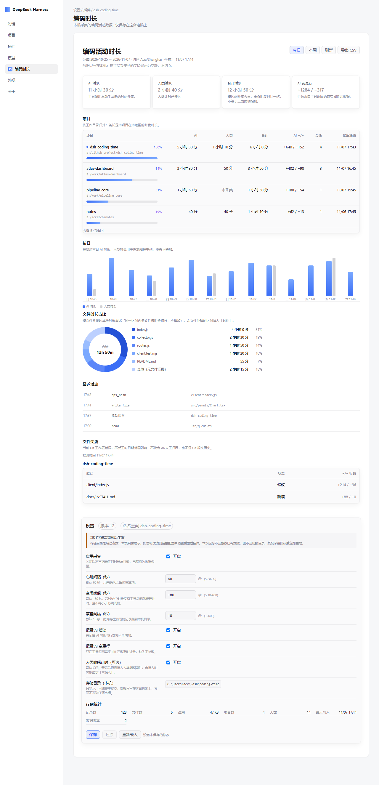
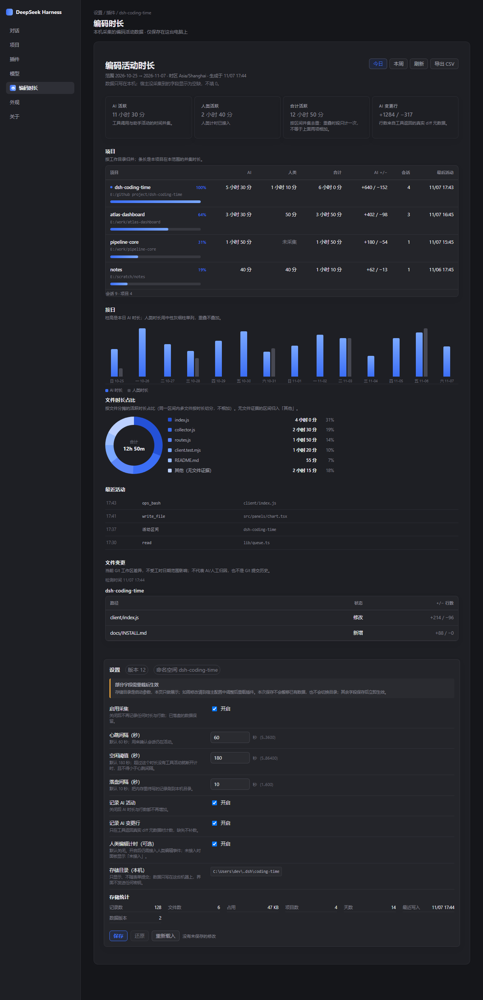
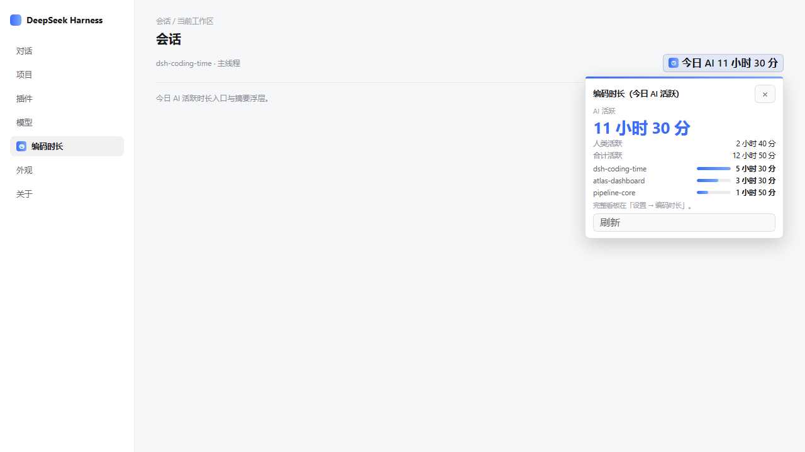

# dsh-coding-time

DeepSeek Harness（DSH）的本地编码活动计时插件：按项目（`cwd`）统计墙钟活跃
时长，基于**真实 diff 元数据**记录增删行，并可选地统计人工编辑时长。所有数据
只留在本机 `~/.dsh` 之下——没有账号、不调用网络服务、不上传任何统计。



<details>
<summary>深色主题</summary>



</details>

会话头会显示今日 AI 活跃时长，点击可展开一个紧凑的摘要浮层。



## 它能做什么

- **按项目统计活跃时长**：记录 AI 活动（工具调用与助手事件）的墙钟区间，
  按工作目录归并。重叠区间按时间**并集**合并，合计不是简单相加。
- **真实行数记账**：增删行只认工具返回的显式 diff 元数据。没有元数据就保持
  未知，绝不补成 0。
- **可选的人工计时**：默认关闭。只有接入编辑器并提供明确的真实输入证据后才
  会启用。
- **按文件时长占比**：活跃区间按触碰到的文件分摊，以环形图展示，并列出每个
  文件的时长与占比。
- **项目时长排行**：按并集活跃时长排序列出项目，附时长横条与占比。
- **按日活动**：逐日展示 AI（以及已接入时的人工）时长柱状图。
- **最近活动与文件变更**：最近事件时间线，以及按项目展示的当前 Git 工作区
  只读快照。
- **设置页**：心跳 / 空闲 / 落盘间隔、采集开关、本机存储目录与存储统计。宿主
  提供可写配置命名空间时可直接编辑。
- **导出 CSV**：把摘要导出为 CSV；未知值与 0 保持区分。

## 数据为什么只在本机

Web 仪表盘挂在 Harness 已有的 `webServer` 上——插件**不新增 HTTP 监听端口**。
它从同源本地路由取数，把 JSONL 写到 `<storageDirectory>/<profile>/`。不调用
任何第三方 API，不外发统计数据，界面也不读取或保存任何凭据。运行时代码只用
Node 内建模块；设置表单使用宿主提供的 `@deepseek-ai/schemastery` peer 依赖
构建配置 schema。

未采集、未接入的字段会明确显示（例如「未采集」「未接入」），绝不用伪造的
`0` 冒充。

## 安装

从 npm 安装：

```
npm install dsh-coding-time@0.1.1
dsh plugin --profile web add dsh-coding-time
```

或直接从 GitHub 仓库安装：

```
dsh plugin --profile web add 'https://github.com/Dclef/dsh-coding-time'
```

需要 Node `>=22.14.0`，以及一个正在运行、且 `dsh` CLI 在 `PATH` 中可用的
Harness 实例。详见 [docs/INSTALL.md](docs/INSTALL.md)。

## 配置（默认值）

| 字段 | 默认值 |
| --- | --- |
| `enabled` | `true` |
| `heartbeatIntervalSeconds` | `60` |
| `idleThresholdSeconds` | `180` |
| `flushIntervalSeconds` | `10` |
| `trackAgentActivity` | `true` |
| `trackAiLines` | `true` |
| `humanTracking.enabled` | `false` |
| `storageDirectory` | `~/.dsh/coding-time` |
| `timezone` | 本机 IANA 时区 |
| `weekStartsOn` | `1`（周一） |
| `exclude` | 常见的构建、版本控制与敏感路径 |

`idleThresholdSeconds` 不得小于 `heartbeatIntervalSeconds`。未知字段、凭据
字段、非法数值 / 时区、非绝对目录一律报错，而不是静默修正。

## 0.1.1 更新

- 看板复用缓存的 `Intl.NumberFormat` 与 `Intl.DateTimeFormat`，减少重复构造开销。
- 缓存按语言与时区隔离，保留非法输入的回退行为，每类最多保留 32 项。

## 开发

```
npm test                                   # 全量测试
npm run check                              # 检查全部 .js 源文件语法
node --test test/summary-contract.test.mjs # 真实 apply + /summary HTTP 契约
npm pack --dry-run                         # 离线打包检查
```

## 状态

实验性、纯本地插件，以源码形式公开供审阅与自行部署。只有当宿主暴露本插件
自己的可写 Config 命名空间时才启用编辑；否则客户端显示明确的只读状态，
并且**零**保存请求。自动化回归通过不代表已完成人工浏览器验收。

## 许可

MIT —— 见 [LICENSE](LICENSE)。

英文文档：[README.md](README.md)。
